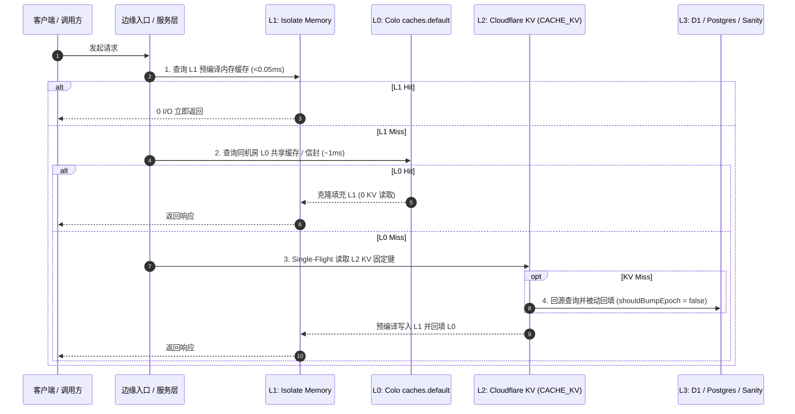

# 00. 架构专篇与对抗巡检模块标准模板 (`docs/00-module-template.md`)

> **用途说明**：本模板定义了项目新增架构域（如 `docs/06-<domain>.md`）或扩展现有领域专篇时的 **标准结构契约**。
> **核心原则**：任何架构设计文档绝不能沦为“纯静态文字说明”，必须与 **`scripts/audits/<NN>-<domain>.audit.ts`（静态对抗探针）** 及 **`test/<domain>.test.ts`（运行时对抗单测）** 形成 `1:1` 物理双向绑定，并受 `scripts/check-preflight.ts` (`DOC-SYNC-GUARD`) 强制校验。

---

## 模块新增 / 演进四步闭环清单 (Co-Evolution Checklist)

当引入新架构模块或沉淀新类型历史故障时，必须按以下 4 步同步落地：

1. **编写/更新架构专篇 (`docs/<NN>-<domain>.md`)**：按下方标准章节模板完成第一性原理推导、数据流拓扑、代码契约及文末「历史故障与对抗挑刺规则索引表」。
2. **编写/更新静态对抗探针与内存级 `verify()` 故障注入 (`scripts/audits/<NN>-<domain>.audit.ts`)**：
   - 声明 `triggerPatterns`（Git Diff 命中路径正则）与 `unitTestFiles`（关联运行时单测文件）；
   - 每个 `rules[]` 探针必须分配唯一 ID（如 `<PREFIX>-ADV-01`），且该 ID **必须** 出现在对应 `docs/<NN>-<domain>.md` 的索引表中（否则 `DOC-SYNC-GUARD` 立即阻断）；
   - 实现 `verify: async (ctx) => AuditViolation[]` 内存级故障注入钩子（动态加载 `src/` 真实模块并注入并发惊群、读写交织、畸形输入等极端边界，严禁将 `verify()` 直接塞入生产 `src/` 代码以免污染 Cloudflare Worker 打包体积）。
3. **编写/更新运行时对抗单测 (`test/<domain>.test.ts`)**：针对核心状态机、边界降级或历史回归场景编写 `node:test` 对抗断言。
4. **注册至总控路由 (`scripts/check-preflight.ts` & `AGENTS.md` & `tech.md`)**：若为全新领域 `06+`，将其挂载至 `ALL_SUITES` 与路由索引表。
5. **只增不擅删红线 (Mandatory Deletion Confirmation)**：修改文档或巡检脚本时，严禁擅自删除任何原有的历史踩坑记录 (`Pitfall 1~24` / `*-ADV-*`)、数据表格或旧文档文件；若评估某项确需废弃或合并移除，必须先向用户列出原因并获得明确确认后方可删除。

---

## 标准章节模板 (复制以下结构创建 `docs/<NN>-<domain>.md`)

```markdown
# <NN>. <领域中文名称> (`docs/<NN>-<domain>.md`)

> **适用场景**：修改 `<关联核心目录或文件列表>`，或排查 `<典型线上症状/指标>` 问题时必读。

---

## 1. 第一性原理推导 (First-Principles Derivation)

### 1.1 物理约束与核心矛盾
- **客观物理边界**：明确本模块面对的底层物理限制（如：Cloudflare Workers 内存/CPU 限制、跨区网络 RTT、浏览器渲染管线、数据库并发锁等）。
- **核心架构推导**：
  1. **推导公理 1**：基于上述物理限制，推导出为什么不能采用常规做法，而必须采用当前架构。
  2. **推导公理 2**：明确读写分离、动静分离或失败降级的刚性边界。

---

## 2. 核心拓扑与 L1 / L0 / KV / L3 状态流转 (Topology & Multi-Tier State Flow)



### 2.1 关键隔离边界与缓存分区映射
- **快路 (Fast-Path)**：0 I/O 或内存命中条件。
- **慢路 / 回源 (Fallback-Path)**：Single-Flight 并发折叠（`profiler.requestMemo` / `inFlightLoad`）、超时控制 (`AbortSignal.timeout(6000)`) 与后台异步化 (`waitUntil`)。

| 分区名称 (`name`) | 账本作用域 (`scope`) | L1 TTL | L2 KV Key | L3 数据源 | 预编译结构与失效触发条件 |
| :--- | :--- | :--- | :--- | :--- | :--- |
| `<cache_name>` | `<CacheLedgerScope>` | `Infinity` / `30_000` | `<fixed_kv_key>` / 无 | `<DB table / Sanity doc>` | `<Set / Map / Bitmask + .refresh() 触发时机>` |

---

## 3. 核心机制与代码契约 (Code Contracts & Invariants)

### 3.1 数据结构 / 接口契约
- 明确单一真理源 (SSOT) 所在文件、Schema 定义、缓存 Key 命名规范及失效作用域 (`CacheLedgerScope`)。

### 3.2 血泪红线 (Non-Negotiable Redlines)
- 明确列出本模块中**严禁出现**的反模式写法（如：严禁无超时裸 `fetch`、严禁单独判断 `img.complete`、严禁三端 Schema 漂移等），并给出标准正例代码。

---

## 4. 历史故障与对抗挑刺规则索引 (`scripts/audits/<NN>-<domain>.audit.ts`)

> 每次在本领域发现新的故障，必须在 `scripts/audits/<NN>-<domain>.audit.ts` 新增 `<PREFIX>-ADV-*` 静态探针或 `PreflightTest.verify()` 内存故障注入，并在此表中同步登记（由 `DOC-SYNC-GUARD` 自动强制校验）。

| 规则 / 测试 ID | 类型 | 挑刺检查目标 | 历史故障根因与防重契约 |
| :--- | :---: | :--- | :--- |
| **`<PREFIX>-ADV-01`** | 静态对抗探针 | `<检查的源码目标与反模式>` | `<历史故障现象与根因> -> <自动化探针拦截逻辑与修复标准>` |
| **`<domain>:runtime-consistency-verify`** | `PreflightTest.verify()` | `<内存级并发/状态一致性故障注入>` | `<注入的极端边界条件与期望的不变量断言>` |
```

