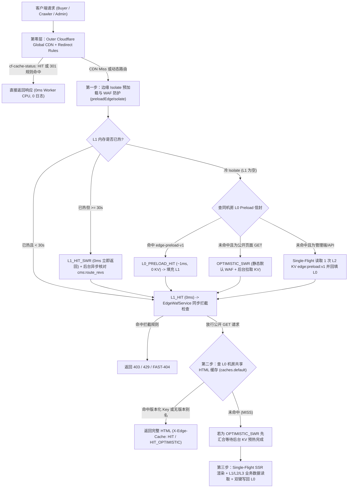

# 01. 五层边缘缓存与状态同步架构 (`docs/01-edge-cache.md`)

> **适用场景**：修改 `src/middleware.ts`、`src/utils/cache.ts`、`src/utils/cmsSync.ts`、`/api/revalidate`、`/api/admin/cache/purge`，或排查 TTFB 耗时、`X-Preload-Status`、`X-Edge-Cache` 命中率问题时必读。

---

## 1. 第一性原理推导 (First-Principles Derivation)

### 1.1 物理约束与核心矛盾
在 Cloudflare Workers 全球 300+ 边缘机房（PoP）架构下，不同存储介质存在数量级上的物理延迟鸿沟：
- **V8 Isolate 进程内存 (L1)**：`< 0.05 ms`（但单个 Isolate 随时可能被回收，且高并发下同一机房会同时拉起多个冷 Isolate）。
- **本机房共享 Cache API (`caches.default`, L0)**：`1 ~ 4 ms`（**同一机房内跨所有 V8 Isolate 物理共享**，无需跨区网络传输）。
- **Cloudflare Workers KV (`CACHE_KV`, L2)**：热键同区 `5 ~ 25 ms`，冷键跨区回源中心存储高达 `150 ~ 250 ms`。
- **源站数据库 / CMS (Supabase Postgres / Sanity, L3)**：跨洋 TLS + 查询耗时 `40 ~ 350 ms`。

**核心架构推导**：
1. **绝不能让每个新拉起的冷 Isolate 都去读一遍 KV**：利用 `caches.default` 同机房跨 Isolate 共享的特性，将 `edge:preload:v1` 聚合包封装为 **L0 Preload 共享信封**。机房第 1 个 Isolate 读 KV 后写入 L0，后续第 2~N 个冷 Isolate 直接从 L0 1ms 克隆内存（`L0_PRELOAD_HIT`，0 KV 读取）。
2. **绝不能让 30 秒心跳阻塞用户主请求**：L1 内存满 30 秒后采用 **SWR（Stale-While-Revalidate）**，主请求 0ms 立即返回 `L1_HIT_SWR`，由 `waitUntil` 在后台异步比对版本账本。
3. **绝不能在全冷机房阻塞公开页面首屏**：公开页面 GET 在 L1+L0 预热包均未命中时走 **`OPTIMISTIC_SWR`**（使用内置静态 WAF 默认规则 + 查询无版本号 L0 HTML 别名），若 L0 HTML 未命中则在进入 Astro SSR 前自动汇合（Join）后台已起飞的 `inFlightHydratePromise`。

### 1.2 六大架构目标与设计原则（原 `cache.md` 完整沉淀）
本方案针对基于 **Astro SSR + Cloudflare Workers + Cloudflare KV + Cloudflare D1 / PostgreSQL + Sanity CMS** 的全球化 B2B 独立站，构建了一套高吞吐、零阻塞、防穿透的多级边缘缓存体系：
1. **热路径零 I/O（Zero-I/O Hot Path）**：99% 以上的正常访问与恶意扫描拦截均在外层 CDN、边缘机房共享缓存（L0 `caches.default`）或 Isolate 内存（L1）中完成，0 次数据库/KV/CMS 请求。
2. **同机房跨 Isolate 零 KV 共享（Colo-Wide L0 Preload Envelope）**：利用 `caches.default` 在同一 Cloudflare 机房（Colo）内跨所有 V8 Isolate 共享的物理特性，将聚合预热包缓存在机房 L0（`https://edge-preload.internal/edge-preload-v1`，TTL 30s）。同机房拉起的第 2~N 个新冷 Isolate 仅需 ~1ms 即可从 L0 完成全部 L1 内存预热（`L0_PRELOAD_HIT`），**0 次 KV 读取**。
3. **非阻塞 SWR 后台心跳（0ms Background Heartbeat Sync）**：L1 内存满 30 秒（可配置 `l1_heartbeat_interval_sec`）后，主请求**零等待**立即返回 `L1_HIT_SWR`（0ms 阻塞），同时通过 `waitUntil` / `runInBackground` 在后台异步读取 `cms:route_revs` 进行 $O(1)$ 整数版本号（`ledger.v`）比对与热替换。
4. **冷启动乐观 SWR 快路（Optimistic SWR + Unversioned L0 Alias）**：当机房内 L1 与 L0 Preload 同时为空时，公开可缓存页面 GET 请求立即使用内置静态默认 WAF 规则（`DEFAULT_SYSTEM_SETTINGS`）完成安全校验，并查询无版本号 L0 HTML 别名键（`HIT_OPTIMISTIC`），后台并发回填 KV；若 L0 HTML 未命中，则在进入 Astro SSR 渲染前自动汇合（Join）后台的单次 `inFlightHydratePromise`，杜绝 SSR 渲染期散落穿透 KV。
5. **二代结构化版本账本（2nd-Gen `RouteRevisionsLedger`）**：`cms:route_revs` 采用 `{ v: number, scopes: Record<CacheLedgerScope, number>, routes: Record<string, number> }` 结构，支持 7 大业务域（`settings | waf | dicts | rbac | config | products | pages`）精准定向失效，并自动修剪超过 100 条且早于 `__layout` 的陈旧路由键。
6. **L1 写入即预编译与请求级去重（Compile-on-Write & Request Memo/SQL Dedup）**：数据进入 L1 时一次性编译为安全 `RegExp`、IPv4/IPv6 CIDR 二进制位掩码、`Set` / `Map` 索引；同一请求内通过 `profiler.requestMemo` 与 `RequestDeduplicatingDbClient` 自动折叠并发相同读取。

---

## 2. 五层缓存拓扑与请求流转



### 2.1 五层流转步骤说明与路由分级隔离边界
1. **第零层：Outer Cloudflare Global CDN + Edge Redirect Rules（耗时 0ms Worker）**
   - 静态资源（`/_astro/*`）、历史旧站 301 重定向规则、已缓存公网页面直接由 Cloudflare 边缘节点返回。
   - 命中时（`cf-cache-status: HIT`）不唤醒 Worker，**0 CPU 消耗、0 数据库/KV 读取、0 日志写入**。
2. **第一步：边缘 Isolate 预加载与 WAF 防护（`preloadEdgeIsolate`）**
   - **L1 已热（< 30s）**：直接返回 `L1_HIT`（0ms）。
   - **L1 满 30s**：立即返回 `L1_HIT_SWR`（0ms），后台通过 `waitUntil` 异步核对 `cms:route_revs` 账本。
   - **冷 Isolate**：优先读取同机房 `caches.default` 中的 L0 Preload 信封（`L0_PRELOAD_HIT`，耗时 ~1ms，0 次 KV 读取）。
   - **全冷公开 GET**：走 `OPTIMISTIC_SWR`（使用内置静态默认 WAF 规则 + 查询无版本 L0 HTML 别名，0ms KV 等待）。
   - **全冷动态/管理端**：通过 Single-Flight 读取 1 次 L2 KV `edge:preload:v1` 并回填 L1 与机房 L0 信封。
3. **第二步：L0 机房共享 HTML 页面缓存（`caches.default`，同机房跨 Isolate 共享，耗时 1~4ms）**
   - **双键写入**：SSR 渲染完成后同时写入版本化 Key（`?__rev=<pathRev>`）与无版本乐观别名 Key。
   - **命中（`HIT` / `HIT_OPTIMISTIC`）**：直接返回完整 HTML，**0 SSR 渲染、0 数据查询**。
   - **未命中（`MISS`）**：若当前处于 `OPTIMISTIC_SWR`，先汇合等待后台 KV 预热完成，再通过 Single-Flight（`inFlightEdgeRenders`）合并并发渲染。
4. **第三步：业务数据三级缓存读取与请求内去重（`EdgeTieredCache` & `KeyedCache`）**
   - **L1 Isolate 进程内存**：零拷贝读取预编译 `Set` / `Map` / `Obj`，带 `profiler.requestMemo` 单请求去重与 `existsGuard` 防穿透守卫（耗时 < 0.05ms）。
   - **L2 Cloudflare KV**：读取精简固定业务 KV 键，回填 L1（同区耗时 5~25ms）。
   - **L3 源站（D1 / PostgreSQL + Sanity CMS）**：仅在 L1/L2 均未命中或后台主动刷新时触发，内置 `RequestDeduplicatingDbClient` 自动折叠单请求内的并发相同 SQL `SELECT`。

**路由分级隔离边界**：
- **公开可缓存路由 (`isPublicCacheablePageGet`)**：`/`、`/products`、`/products/[slug]`、`/[...slug]` 及 `/de/*`、`/fr/*`、`/es/*` 多语言等价路径（无 `preview/draft/purge/__` 参数且无管理端会话绕过需求）。
- **私有强一致性路由（严禁 L0 HTML 缓存与 `OPTIMISTIC_SWR`）**：
  - `/admin/*`、`/api/*`、`/orders/*`、`/account/*`：依赖登录 Cookie 与 RBAC DataScope，且要求 Read-Your-Writes。
  - 这些路由在中间件中强制执行 `X-Edge-Cache: BYPASS` + `Cache-Control: private, no-store`，但**依然完整享受 `L1_HIT` / `L0_PRELOAD_HIT` 带来的 0ms 配置、WAF、RBAC 与字典预热红利**。
- **PJAX 壳请求 (`X-Shell-Request: 1`)**：仅返回 `#shell-main-canvas` 局部 HTML，必须绕过完整页面 L0 缓存并附带 `Vary: X-Shell-Request, Accept-Language`，防止局部片段污染整页 HTML 缓存。

### 2.2 各缓存层级物理对比表

| 层级 | 存储介质 | 响应延迟 | 作用范围 | 核心职责 |
| :--- | :--- | :--- | :--- | :--- |
| **Outer CDN** | Cloudflare 全球边缘 CDN 节点 | **1 ~ 5 ms** | 当前边缘机房 (PoP) | 拦截历史旧站 301 重定向、静态资源与公网 `s-maxage` 缓存，命中时不唤醒 Worker |
| **L0** | Worker `caches.default` (HTML + Preload 信封) | **1 ~ 4 ms** | 当前边缘机房 (跨 Isolate 共享) | 共享完整 HTML（版本化 Key + 无版本别名）及 30s `edge-preload-v1` 信封 |
| **L1** | V8 Isolate 内存 (`EdgeTieredCache` / `Map`) | **< 0.05 ms** | 当前 Worker Isolate | 零拷贝读取预编译对象（WAF 规则树、Slug `Set`、全局配置、30s 动态计数缓存） |
| **L2** | Cloudflare Workers KV (`CACHE_KV`) | **5 ~ 200 ms** | 全球边缘节点持久化共享 | 持久化存储 `edge:preload:v1`、`cms:route_revs` 账本及各业务 JSON（无 `@epoch` 冗余键） |
| **L3** | Cloudflare D1 / PostgreSQL + Sanity CMS | **40 ~ 350 ms** | 全球唯一真实数据源 | 存储系统配置、WAF 规则、RBAC、字典、订单、用户及 Sanity CMS 文档（带请求内 SQL 去重） |

---

## 3. 核心机制与代码契约

### 3.1 全局聚合冷启动包 (`edge:preload:v1`) 与 L0 信封
- **L2 KV Key**：`edge:preload:v1`
- **L0 信封 Key**：`https://edge-preload.internal/edge-preload-v1`（`Cache-Control: public, max-age=30, s-maxage=30`，同机房所有 Isolate 共享，Purge 时主动清除）
- **包含的聚合字段**：`updatedAt` + 6 大核心数据：
  1. `routeRevs`（二代结构化版本账本）
  2. `systemSettings`（系统设置与 WAF 阈值）
  3. `wafRuntime`（WAF 规则与 IP ACL 原始集，进入 L1 时即时编译为位掩码与安全正则）
  4. `siteConfig`（Sanity 全局站点配置）
  5. `rfqSettings`（Sanity 询盘配置）
  6. `pageSlugs` & `productSlugs`（预编译为 `Set<string>`，用于动态路由 O(1) 存在性守卫 `existsGuard`）
- **核心价值**：
  1. 机房首个冷 Isolate 仅需 **1 次 KV 读取** 即可一次性激活 6 大核心 L1 内存分区，并自动回填到机房 L0；
  2. 同机房后续拉起的所有冷 Isolate 直接命中 L0 信封（`L0_PRELOAD_HIT`），**0 次 KV 读取**完成冷启动。

### 3.2 二代结构化版本账本 (`cms:route_revs`)
```json
{
  "v": 1763850000000,
  "scopes": {
    "settings": 1763850000000,
    "waf": 1763840000000,
    "dicts": 1763830000000,
    "rbac": 1763820000000,
    "config": 1763810000000,
    "products": 1763850000000,
    "pages": 1763800000000
  },
  "routes": {
    "__layout": 1763810000000,
    "/": 1763850000000,
    "/products": 1763850000000,
    "/products/silk-slip": 1763850000000
  }
}
```
- **$O(1)$ 心跳快路**：`runHeartbeatSync` 只需比对 `heartbeatLedger.v === localRouteRevs.v` 整数是否相等。
- **定向 Scope 失效**：当 `v` 变化时，逐一比对 7 个 `scopes`，仅调用 `invalidateRegisteredCachesByScope(scope)` 失效发生变更的业务域，绝不清空未变更的 L1 缓存。
- **自动防膨胀修剪 (`pruneRouteRevs`)**：当 `routes` 键数量 `> 100` 时，自动删除所有时间戳 `<= routes.__layout` 的陈旧子路由键。

### 3.3 中间件四级极速预热流水线（`preloadEdgeIsolate`）、L0 HTML 双键缓存与请求级去重
每次非静态资源请求进入 `src/middleware.ts` 时调用 `preloadEdgeIsolate(cfEnv, false, allowOptimistic)`：
1. **L1 内存命中（`L1_HIT` / `L1_HIT_SWR`，耗时 0ms）**：
   - 只要当前 Isolate 的 L1 已填充，**无论是否满 30 秒，永远立即返回当前 L1 引用（0ms 阻塞）**。
   - 若距离上次同步未满 `l1_heartbeat_interval_sec`（默认 30s），返回 `preloadStatus = 'L1_HIT'`。
   - 若已满 30s，立即将 `localPreloadLoadedAt = now` 顺延，并通过 `runInBackground(runHeartbeatSync(cfEnv))` 在后台异步检查 KV 中的 `cms:route_revs`，当前请求直接返回 `preloadStatus = 'L1_HIT_SWR'`。
2. **同机房 L0 共享信封命中（`L0_PRELOAD_HIT`，耗时 ~1ms，0 KV 读取）**：
   - 当请求落到同一机房新拉起的冷 Isolate（L1 为空）时，首先调用 `readPreloadBundleFromL0()` 检查机房共享的 `caches.default`。
   - 命中后直接调用 `hydrateFromPreloadBundle` 瞬间填满 6 大 L1 缓存，并在后台触发一次 `runHeartbeatSync` 核对账本，返回 `preloadStatus = 'L0_PRELOAD_HIT'`。
3. **全冷公开页面乐观快路（`OPTIMISTIC_SWR`，耗时 0ms KV 等待）**：
   - 若 L1 与 L0 Preload 均未命中，且当前请求为公开可缓存页面 GET（由 `isPublicCacheablePageGet` 判定，严格排除 `/admin/*`、`/api/*`、`/orders`、`/account` 及带 `preview/draft/purge` 参数的请求）：
   - 后台异步启动 `runInBackground(hydratePreloadFromKv(cfEnv, now))`（带 `inFlightHydratePromise` Single-Flight 锁）；
   - 当前请求立即携带 `wafSettings: DEFAULT_SYSTEM_SETTINGS`（确保静态 OWASP SQLi/XSS、扫描路径、旧站 `/product-tag/` Fast-404 及速率限制 100% 同步生效）与 `routeRevisions: { v: 0 }` 进入下一步查无版本 L0 HTML 别名缓存。
4. **L2 KV 单次聚合拉取（`L2_KV_HIT` / `L3_MISS`）**：
   - 对于不可走乐观快路的请求（或 `OPTIMISTIC_SWR` 遭遇 L0 HTML 缓存未命中准备进入 SSR 渲染前），汇合等待 `inFlightHydratePromise` 读取 1 次 `edge:preload:v1`，填满 L1 并写回机房 L0 信封。
5. **L0 HTML 双键写入（Versioned Key + Unversioned Optimistic Alias）**：
   - SSR 渲染出 200/404 可缓存响应后，同时向 `caches.default` 写入：
     - **版本化主键**：`https://domain/path?__rev=<pathRev>`（供 `L1_HIT` / `L0_PRELOAD_HIT` 精确版本匹配）；
     - **无版本乐观别名键**：`https://domain/path`（在 `cache.put` 消费流前先 `.clone()`，专供 `OPTIMISTIC_SWR` 在 `pathRev = 0` 时直接命中 `HIT_OPTIMISTIC`）。
   - 执行 `?purge=1` 或后台 `purgeEdgeHtmlCache` 时，同时物理删除带版本号主键与无版本号别名键。
6. **Optimistic Miss 自动汇合 (Join-before-SSR)**：
   - 若 `OPTIMISTIC_SWR` 请求查询 L0 无版本 HTML 发生 `MISS`，在调用 Astro `next()` 进入 SSR 前，中间件强制执行 `await preloadEdgeIsolate(cfEnv, false, false)` 汇合等待后台已启动的 `inFlightHydratePromise`，确保 SSR 期间 L1 100% 已热，且最终生成的 HTML 以真实的 `__rev=<pathRev>` 写入 L0。
7. **请求级内存去重与 SQL 并发折叠**：
   - **`profiler.requestMemo`（单请求内零重复调用）**：`SiteConfigService.getConfig()`、`RfqSettingsService.getSettings()` 及 `EdgeTieredCache.get()` 在单次 HTTP 请求生命周期内通过 `profiler.requestMemo`（基于 `AsyncLocalStorage`）缓存 in-flight Promise，消除并发冷读穿透与页面组件和 `Layout.astro` 之间的重复调用。
   - **`RequestDeduplicatingDbClient`（单请求内相同 SELECT 自动折叠）**：在单次请求内，并发发起的相同 SQL `SELECT`（`query` / `first`）自动共享同一个 in-flight Promise，并对返回数组做浅拷贝隔离；一旦发生 `execute()` 或 `batch()` 写操作，立即清空 `inFlightReads`，100% 保证 Read-Your-Writes。

### 3.4 全量缓存分区矩阵 (`src/utils/cache.ts`，已裁剪全部冗余 KV Key)

| 分区名称 (`name`) | 作用域 (`scope`) | 结构类型 | L1 TTL | L2 KV Key | Epoch 账本域 | L3 数据源 | 核心预编译、派生与防穿透特性 |
| :--- | :--- | :--- | :--- | :--- | :--- | :--- | :--- |
| `system_settings` | `settings` | Singleton | `Infinity` | `sys:settings:v1` | `__settings` (`settings`) | DB `system_settings` | 过滤 `table_pref:%`；归一化 `waf_rule_config` |
| `waf_runtime` | `waf`, `settings` | Singleton | `Infinity` | `waf:compiled_ruleset:v1` | `__waf` (`waf`) | DB `waf_rules` + `waf_ip_acl` | **L1 预编译**：安全 RegExp、IPv4/IPv6 CIDR 位掩码、`listWafRules`/`listWafIpAcl` 直接复用 |
| `cms:siteConfig` | `config` | Singleton | `Infinity` | `cms:siteConfig` | `config` | Sanity `siteConfig` | 绑定 `profiler.requestMemo`，单请求内页面与 `Layout.astro` 共享同一引用 |
| `cms:rfqSettings` | `config` | Singleton | `Infinity` | `cms:rfqSettings` | `config` | Sanity `rfqSettings` | 绑定 `profiler.requestMemo`，询盘配置与快捷按钮开关 |
| `cms:products:all` | `products` | Singleton | `Infinity` | `cms:products:all` | `products` | Sanity `PRODUCT_CARD_FIELDS` | 轻量卡片投影（裁剪大图库，体积降 80%）；`onUpdate` 自动在内存派生 `prod:slugs` 并预热单品缓存 |
| `prod:slugs` | `products` | Singleton | `Infinity` | **无 (由 `cms:products:all` 内存派生)** | `products` | 内存派生 / Sanity 兜底 | **L1 预编译为 `Set<string>`**，消除了冗余的 `cms:product_slugs:v1` KV 键 |
| `page:slugs` | `pages` | Singleton | `Infinity` | `cms:page_slugs:v1` | `pages` | Sanity page slugs | **L1 预编译为 `Set<string>`**，作为动态页面 `page:doc` 的前置守卫 (`existsGuard`) |
| `cms:categories:all` | `products` | Singleton | `Infinity` | `cms:categories:all` | `products` | Sanity categories | 分类聚合与商品计数统计 |
| `cms:catalogSettings` | `products` | Singleton | `Infinity` | `cms:catalogSettings` | `products` | Sanity catalogSettings | 商品目录页头部与筛选配置 |
| `cms:productStorySettings` | `products` | Singleton | `Infinity` | `cms:productStorySettings` | `products` | Sanity storySettings | 详情页工艺故事与 OEKO-TEX / Lonati 认证卡片 |
| `prod:details` | `products` | Keyed Map | `Infinity` | `cms:product:<slug>` | 随 `products` 域刷新 | Sanity 单品完整文档 | 绑定 `existsGuard` (`prod:slugs`) + 30s 负缓存，未知 slug **0 KV / 0 Sanity 查询** |
| `page:doc` | `pages` | Keyed Map | `Infinity` | `cms:page:<slug>` | 随 `pages` 域刷新 | Sanity 单页完整文档 | 消除了冗余的 `cms:pages:all`；绑定 `existsGuard` (`page:slugs`) + 30s 负缓存 |
| `dict_groups` | `dicts` | Singleton | `Infinity` | `dicts:groups:v1` | `__dicts` (`dicts`) | DB `sys_dict_groups` | 缓存字典分类与启用条目计数，写字典时联动 `.refresh()` |
| `dicts_all` | `dicts` | Singleton | `Infinity` | `dicts:all:v1` | `__dicts` (`dicts`) | DB `sys_dict_items` | **L1 预编译**：按 `group_code` 分组索引与键值映射 |
| `rbac_roles` | `rbac` | Singleton | `Infinity` | `rbac:roles:v1` | `__rbac` (`rbac`) | DB `admin_roles` | 静态角色权限矩阵缓存 |
| `rbac_members` | `rbac` | Singleton | `Infinity` | `rbac:members:v1` | `__rbac` (`rbac`) | DB `admin_members` | **动静分离**：仅存纯静态成员与角色绑定；`listActiveTeamMembersLite` 直接从内存派生 |
| `rbac_member_stats` | `rbac` | Singleton | **`30_000` (30s)** | **无 (纯 L1)** | 无 | DB `orders` + `users` | **动静分离**：承载易变的 `assigned_orders`、`last_login_at` 等统计，不污染静态 KV |
| `users:status` | `users` | Keyed Map | **`30_000` (30s)** | **无 (纯 L1)** | 无 | DB `users` | 登录态校验与封禁状态；支持 `id:` 与 `email:` 双键索引，0 DB 校验 |
| `orders:pending_count` | `orders` | Singleton | **`30_000` (30s)** | **无 (纯 L1)** | 无 | DB `orders` | 后台左侧边栏待处理询盘角标；写订单立即失效，后台切换页面 0 DB 查询 |
| `logs_overview` | `logs` | Keyed Map | **`30_000` (30s)** | **无 (纯 L1)** | 无 | DB `system_error_logs` | 按时间窗口 (`1h/24h/7d/30d`) 缓存日志统计与 Top 5 慢请求瓶颈；`/admin/waf` 通过 `includeOverview: false` 跳过 |

---

## 4. 写入失效与自动预热契约 (Write-Through & Prewarm)

```mermaid
flowchart LR
    Write["后台配置修改 / RBAC 变更 / Sanity Webhook (/api/revalidate)"] --> Refresh["EdgeTieredCache.refresh() 或 syncCmsMutation()"]
    Refresh --> L3Fetch["强制回源 L3 (Sanity liveClient useCdn:false 或主库)"]
    L3Fetch --> Compile["L1 写入即预编译 (onUpdate 派生 prod:slugs / 编译 WAF 位掩码)"]
    Compile --> Bump["persistToKv(shouldBumpEpoch=true) -> 更新 cms:route_revs (v + scopes[scope])"]
    Bump --> RebuildPreload["重建 edge:preload:v1 并覆写同机房 L0 Preload 信封"]
    RebuildPreload --> Purge["purgeEdgeHtmlCache: 删 L0 信封 + L0 双键 HTML + Cloudflare Zone CDN"]
    Purge --> Prewarm["runInBackground(prewarmEdgeRoutes): 内部自预热 Top 8 核心路由重填 L0 HTML"]
```



1. **严禁被动读触发写版本**：L1/L2 Miss 回源 L3 时，`persistToKv(..., shouldBumpEpoch = false)` 只回填固定 KV 键，严禁递增 `cms:route_revs` 或生成任何 `@<epoch>` 历史垃圾键。
2. **单一职责版本递增**：所有 `EdgeTieredCache` 分区在 `.refresh()` / `.set()` 时由 `persistToKv(..., true)` 内部统一触发一次 `bumpCacheEpoch(this.epochKey)`，外部业务层（如 `settings.repo.ts`、`waf.repo.ts`、`dicts.ts`、`rbac.repo.ts`）不再重复调用 `bumpCacheEpoch`。
3. **Sanity CMS 内容变更与自动后台预热（`syncCmsMutation` + `purgeEdgeHtmlCache` + `prewarmEdgeRoutes`）**：
   - 当 Sanity Webhook（`/api/revalidate`）、后台保存配置（`/api/admin/settings`）或手动清理缓存（`/api/admin/cache/purge`）触发时：
   - **定向刷新受影响 KV 与账本 Scope**：根据 `docType` 仅更新受影响的 Scope（`config` / `products` / `pages`）及对应路由时间戳，写入 `cms:route_revs` 并重建 `edge:preload:v1`（同步更新机房 L0 信封）；
   - **清理 L0 HTML 与外层 Cloudflare CDN**：`purgeEdgeHtmlCache` 先清除机房 L0 Preload 信封，再并发删除 `caches.default` 中的多语言 URL（含无版本与 `?__rev=` 版本化 URL），最后调用 Cloudflare Zone Purge API 清理全球外层 CDN；
   - **自动后台边缘预热（`prewarmEdgeRoutes`）**：清理完成后，通过 `runInBackground` 自动优先预热核心路由（`/`、`/products`、当前变更路径及 `/about`、`/private-label`、`/contact`，上限 `maxRoutes = 8`），先预热 L1/L2 核心数据，再发起内部 `fetch`（携带 `User-Agent: Cloudflare-Edge-Warmup/1.0`，日志中表现为 `127.0.0.1` 或 `2a06:98c0:3600::103`）将最新 HTML 重新填满 L0 缓存，确保真实买手访问永远命中热缓存。

### 4.1 边缘诊断响应头与各场景基准性能汇总
每个经过 `src/middleware.ts` 的请求都会注入完整诊断头：
- `X-Edge-Node`: `<colo>:<isolateId>`（如 `SIN:067856fd`，直观区分机房与 V8 实例）
- `X-Preload-Status`: `L1_HIT` | `L1_HIT_SWR` | `L0_PRELOAD_HIT` | `OPTIMISTIC_SWR` | `L2_KV_HIT` | `L3_MISS` | `BYPASS`
- `X-Edge-Cache`: `HIT` | `HIT_OPTIMISTIC` | `MISS` | `BYPASS`
- `X-Perf-Spans`: `kv=<ms>,d1=<ms>,sanity=<ms>,total=<ms>`
- `Server-Timing`: 标准浏览器 DevTools Network 瀑布流耗时指标

| 典型业务场景 | 外层 CDN / L0 状态 | Preload 状态 | KV 读写次数 | DB / Sanity 查询次数 | 边缘响应耗时 |
| :--- | :---: | :---: | :---: | :---: | :---: |
| **外层 Cloudflare CDN 直接命中（静态资源 / 旧站 301 / 公网缓存）** | `cf-cache-status: HIT` | 不唤醒 Worker | **0** | **0** | **1 ~ 5 ms** |
| **热 Isolate 访问公开页面（30s 窗口内）** | `X-Edge-Cache: HIT` | `L1_HIT` | **0** | **0** | **1 ~ 4 ms** |
| **热 Isolate 满 30s 触发非阻塞后台心跳** | `X-Edge-Cache: HIT` | `L1_HIT_SWR` | **主请求 0** (后台异步 1 次) | **0** | **1 ~ 4 ms** |
| **同机房新拉起的第 2~N 个冷 Isolate 访问任何页面** | `X-Edge-Cache: HIT` | `L0_PRELOAD_HIT` | **0** (命中机房 L0 信封) | **0** | **5 ~ 25 ms** |
| **机房 L1+L0 信封均冷，但 L0 已有 HTML 别名缓存** | `X-Edge-Cache: HIT_OPTIMISTIC` | `OPTIMISTIC_SWR` | **主请求 0** (后台异步回填) | **0** | **5 ~ 25 ms** |
| **管理员在后台切换 `/admin/roles`、`/admin/dicts`、`/admin/pages`** | `BYPASS` (私密隔离) | `L1_HIT` / `L0_PRELOAD_HIT` | **0** | **0** | **4 ~ 15 ms** |
| **恶意扫描器探测 `/wp-login.php` 或旧站 `/product-tag/*`** | `FAST-404` / `BLOCK` | `L1_HIT` | **0** | **0** | **< 1 ms** |


---

## 5. 历史故障与对抗挑刺规则索引 (`scripts/audits/01-edge-cache.audit.ts`)

> 每次在本领域发现新的缓存穿透、流锁死或脏读故障，必须在 `scripts/audits/01-edge-cache.audit.ts` 新增 `CACHE-ADV-*` 探针，并在此表中同步登记。

| 规则 / 测试 ID | 挑刺检查目标 | 历史故障根因与防重契约 |
| :--- | :--- | :--- |
| **`CACHE-ADV-01`** | L0 HTML 双键缓存 `.clone()` 与 Optimistic Miss Join-before-SSR | `caches.default.put()` 会锁定 `Response.body` 流，双键写入前必须 `.clone()`；`OPTIMISTIC_SWR` 在 L0 Miss 进入 Astro `next()` 前必须 `await preloadEdgeIsolate(cfEnv, false, false)` 汇合。 |
| **`CACHE-ADV-02`** | 被动读回源零版本递增 & 零 `@epoch` 冗余键 | L1/L2 被动 Miss 回源时 `persistToKv` 的 `shouldBumpEpoch` 必须为 `false`，且严禁生成 `${kvKey}@${epoch}` 动态后缀键。 |
| **`CACHE-ADV-03`** | 私有路由与 PJAX 局部请求严禁混入公共 L0 缓存 | `/admin`、`/api`、`/orders`、`/account` 及 `X-Shell-Request: 1` 必须排除在公共 L0 HTML 缓存之外，防止跨用户串数据或刷出半截无壳 HTML。 |
| **`CACHE-ADV-04`** | 持久化 L1+L2 分区强制绑定 `CacheLedgerScope` | 凡配置了 `kvKey` 的 `createTieredCache` 必须声明 `scope`，确保 `cms:route_revs` 心跳变更时能跨 Isolate 定向失效 L1。 |
| **`01-edge-cache:runtime-consistency-verify`** | 内存级 `PreflightTest.verify()`（Single-Flight + Scope 隔离 + `L0 <-> L1` 状态一致性） | 15 并发冷读断言 `l3LoadCount === 1`；`invalidateRegisteredCachesByScope('dicts')` 零误伤 `settings`；向 `caches.default` 注入 L0 信封并挂载 KV 炸弹探针，断言冷 Isolate 返回 `L0_PRELOAD_HIT`、0 KV 读取且 `L0 <-> L1` 版本 100% 一致。 |

