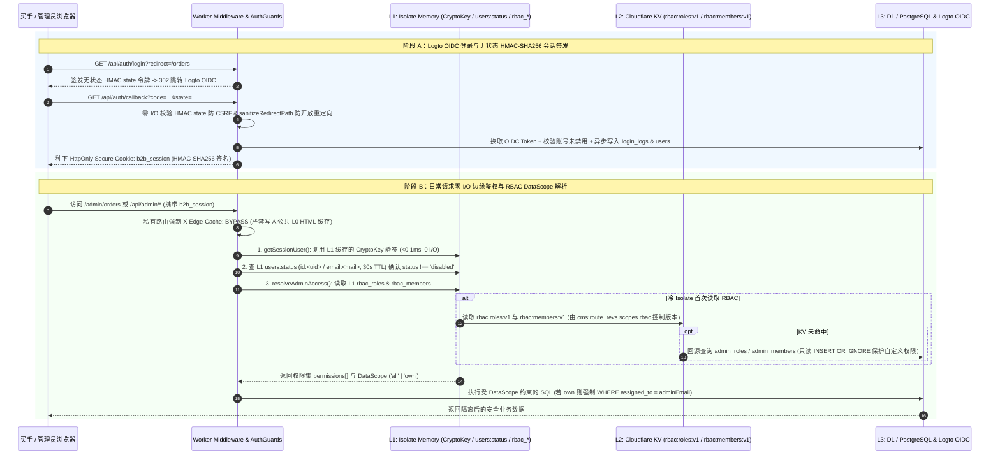

# 02. 双引擎数据库 (D1/Postgres)、零 I/O 鉴权与动静分离 RBAC 架构 (`docs/02-db-auth-rbac.md`)

> **适用场景**：修改 `src/db/*`、`db/schema*.sql`、`src/utils/auth.ts`、`src/utils/authGuards.ts`、`src/utils/rbac.ts`、`/api/auth/*`、`/api/admin/members|roles|users|dicts`，或优化 SQL 慢查询时必读。

---

## 1. 第一性原理推导 (First-Principles Derivation)

### 1.1 物理约束与核心矛盾
1. **双引擎部署需求**：系统需同时支持 Cloudflare 原生边缘 SQLite (`D1`) 与云端高并发 PostgreSQL (`Supabase / Cloudflare Hyperdrive`)，业务仓储层 (`src/db/*.repo.ts`) 绝不能维护两套割裂的业务代码。
2. **跨区数据库 RTT 昂贵**：Worker 节点到中心 PostgreSQL 单次查询 RTT 约 `40 ~ 180 ms`。如果单次页面渲染触发多次重复 SQL、或因 `OR` 连接导致无法走 B-Tree 索引全表扫描，延迟会呈线性甚至指数级叠加。
3. **权限矩阵低频变动 vs 业务统计高频变动**：角色与团队成员编制几天才改一次，而成员名下的跟单数 (`assigned_orders`) 与最后登录时间 (`last_login_at`) 每分钟都在变。若混在同一个 KV 键里，会导致静态权限缓存频繁失效。

---

## 2. 双引擎数据库透明适配层 (`src/db/client.ts`)

### 2.1 自动方言转换与连接净化
- **引擎自动识别 (`resolveDbClient`)**：
  - 若环境变量配置了 `HYPERDRIVE` 绑定或 `SUPABASE_DB_URL` / `DATABASE_URL`，自动启用 `PostgresDbClient`（通过 `sanitizePostgresConnectionString` 自动剥离 `pgbouncer`、`connection_limit`、`schema` 等会导致 `postgres.js` 报错的非标参数，并保留 `sslmode`）。
  - 否则无缝回退至 Cloudflare D1 (`D1DbClient`) 或本地测试内存库。
- **SQL 透明重写 (`toPostgresSql`)**：
  - 占位符重写：将 SQLite 的 `?` 自动按序重写为 PostgreSQL 的 `$1, $2, ...`（跳过单引号字符串字面量内部的 `?`）。
  - 语法重写：自动转换 `INSERT OR IGNORE INTO` -> `INSERT INTO ... ON CONFLICT DO NOTHING`，`datetime('now')` -> `CURRENT_TIMESTAMP`。
- **跨方言 UTC 时间字典序对齐 (`formatUtcCutoff` / `formatUtcSqlTimestamp`)**：
  - 无论是 SQLite 还是 Postgres，所有传入 `WHERE created_at >= ?` 的时间参数统一格式化为 **`YYYY-MM-DD HH:MM:SS`（空格分隔、无 `T` 与 `Z` 后缀的 UTC 字符串）**，保证与数据库默认 `CURRENT_TIMESTAMP` 字典序比较 100% 精确一致。

### 2.2 请求级并发 SQL 去重 (`RequestDeduplicatingDbClient`)
- **工作原理**：每个进入中间件的请求都在 `RequestProfiler` (`AsyncLocalStorage`) 中包裹一层 `RequestDeduplicatingDbClient`。
- **并发读折叠**：同一请求生命周期内并发执行完全相同的 `SELECT`（相同 SQL + 相同绑定参数 JSON）时，直接复用同一个 in-flight Promise，并对返回的行数组做浅拷贝 (`rows.map(r => ({ ...r }))`)，防止调用方原地修改污染共享结果。
- **写后即读屏障 (Read-Your-Writes Barrier)**：一旦在请求内调用了 `execute()` 或 `batch()` 写操作，**立即清空 `inFlightReads` Map**，确保同一请求后续的读取一定穿透获取最新落库状态。

### 2.3 索引矩阵与 SQL 性能红线 (`src/db/schema.ts`)
1. **严禁在 `JOIN ON` 中使用跨列 `OR` 条件**：
   - 反例：`LEFT JOIN orders o ON (o.user_id = u.id OR o.buyer_email = u.email)` 会导致 SQLite 与 Postgres 放弃索引退化为 $O(N \times M)$ 笛卡尔积全表扫描。
   - 正解（见 `src/db/users.repo.ts` `listAdminUsers`）：拆分为 `UNION` / `UNION ALL` 关联子查询，分别精准命中 `idx_orders_user_id` 与 `idx_orders_buyer_email`，并显式赋予子查询别名（`AS o_all`）与单参数 `MAX(created_at)`。
2. **核心复合索引契约**：
   - `idx_orders_created_at (created_at DESC)`：订单列表默认时间倒序扫描。
   - `idx_orders_assigned_status_created (assigned_to, status, created_at DESC)`：跟单员 DataScope 过滤 + 状态筛选 + 排序一次索引覆盖。
   - `idx_users_login_created (last_login_at DESC, created_at DESC)`：客户 CRM 列表默认排序。
   - `idx_error_logs_waf_dedupe_v2 (source, client_ip, error_code, id DESC)`：WAF 连续拦截日志合并查询 (`ORDER BY id DESC LIMIT 1`) 一次 B-Tree 定位。

---

## 3. 零 I/O 边缘身份认证 (`src/utils/auth.ts` & Logto OIDC)

### 3.1 会话签名与无状态校验
- **登录链路 (`/api/auth/login` -> `/api/auth/callback`)**：
  - OAuth `state` 采用无状态 HMAC-SHA256 签名令牌（内含时间戳与 `sanitizeRedirectPath` 安全站内重定向路径校验，防 CSRF 与开放重定向攻击）。
  - 登录成功后签发 `b2b_session` HttpOnly Cookie，并在后台异步记录登录审计日志 (`logins.repo.ts`) 与同步买手档案 (`users.repo.ts`)。
- **零 I/O 边缘验签 (`getSessionUser`)**：
  - 使用 Web Crypto API `HMAC-SHA256` 校验 `b2b_session`；在 Isolate 内存中按密钥指纹缓存导入后的 `CryptoKey` (`cachedHmacKey`)，单次验签耗时 `< 0.1 ms`，**0 数据库 / 0 KV I/O**。
- **封禁状态 30s L1 守卫 (`users:status`)**：
  - 通过 `users.repo.ts` 的 `users:status` L1 缓存（支持 `id:<userId>` 与 `email:<email>` 双键索引，30s TTL）快速校验账号是否被禁用 (`status === 'disabled'`)；管理员在后台禁用用户时立即调用 `invalidateUserStatusCache` 清除。

---

## 4. 动静分离 RBAC 权限与 DataScope 体系 (`src/db/rbac.repo.ts` & `src/utils/rbac.ts`)

### 4.1 角色与成员缓存的动静分离
| 层级 | 缓存分区 | 存储策略 | 包含字段 | 失效触发时机 |
| :--- | :--- | :--- | :--- | :--- |
| **静态角色层** | `rbac_roles` | L1 (`Infinity`) + L2 KV (`rbac:roles:v1`) | `code`, `name`, `permissions[]`, `data_scope`, `is_system` | 仅在增删改角色权限时 `.refresh()` |
| **静态成员层** | `rbac_members` | L1 (`Infinity`) + L2 KV (`rbac:members:v1`) | `email`, `name`, `role_code`, `status`, `department` | 仅在增删改团队成员或角色分配时 `.refresh()` |
| **动态统计层** | `rbac_member_stats` | **纯 L1 (`30s`)，不写 KV** | `assigned_orders`, `assigned_customers`, `last_login_at`, `last_ip` | 仅在打开 `/admin/members` 调用 `listAdminMembersWithStats()` 时按需装配 |

- **轻量成员下拉列表 (`listActiveTeamMembersLite`)**：在订单列表 `/admin/orders` 与客户列表 `/admin/users` 渲染“指派跟单员”下拉框时，直接从内存 `listAdminMembers()` 过滤 `status === 'active'` 派生，**0 次数据库查询**。
- **保护自定义角色权限**：冷启动 `DDL_STATEMENTS` 仅使用 `INSERT OR IGNORE` 初始化默认角色，**严禁**在启动 DDL 中执行覆盖 `admin_roles.permissions` 的 `UPDATE` 语句。

### 4.2 权限校验与 DataScope 数据越权隔离 (`src/utils/authGuards.ts`)
- **超级管理员与联席管理员 (`Super Admin` / `co_admin_emails`)**：拥有 `data_scope = 'all'` 与全量权限点。
- **行级数据隔离 (`DataScope: 'all' | 'own'`)**：
  - 当跟单员角色的 `data_scope === 'own'` 时：
    - 查询订单列表 (`orders.repo.ts`) 与客户列表 (`users.repo.ts`) 强制追加 `WHERE assigned_to = ?` 过滤条件；
    - 操作单条订单 (`/api/admin/orders/[id]/*`) 或客户时，服务端必须校验记录的 `assigned_to` 是否等于当前登录管理员邮箱，严禁仅靠前端隐藏按钮。
- **买手端数据隔离 (`/orders` & `/api/orders/*`)**：
  - 买手只能查询或导出满足 `user_id = session.id OR LOWER(buyer_email) = LOWER(session.email)` 的自身询盘单。

---

## 5. 历史故障与对抗挑刺规则索引 (`scripts/audits/02-db-auth-rbac.audit.ts`)

> 每次在本领域发现新的慢 SQL、方言不兼容或鉴权漏洞，必须在 `scripts/audits/02-db-auth-rbac.audit.ts` 新增 `DB-ADV-*` 探针，并在此表中同步登记。

| 规则 / 测试 ID | 挑刺检查目标 | 历史故障根因与防重契约 |
| :--- | :--- | :--- |
| **`DB-ADV-01`** | 严禁 SQL `JOIN ON` 跨列 `OR` 笛卡尔全表扫描 | `LEFT JOIN orders o ON (o.user_id = u.id OR o.buyer_email = u.email)` 会导致 SQLite/Postgres 均放弃索引，必须改写为 `UNION` / `UNION ALL` 关联索引子查询。 |
| **`DB-ADV-02`** | 双引擎 SQL 方言与 UTC 时间戳兼容性 | 禁止在 SQL 中使用 PostgreSQL 不兼容的双参数 `MAX(a, b)` 标量写法；时间过滤必须使用 `formatUtcCutoff` 空格分隔 UTC 字符串。 |
| **`DB-ADV-03`** | `/api/admin/*` 零信任鉴权守卫全覆盖 | 所有 `/src/pages/api/admin/**/*.ts` 路由必须调用 `authGuards.ts` / `auth.ts` 鉴权守卫，严禁裸奔。 |
| **`DB-ADV-04`** | RBAC 静态角色权限严禁被冷启动 DDL `UPDATE` 覆盖 | `rbac.repo.ts` 初始化仅允许 `INSERT OR IGNORE`，严禁在启动时 `UPDATE admin_roles SET permissions = ...` 抹除后台自定义角色权限。 |
| **`DB-ADV-05`** | 三方 Schema 表与索引集合一致性 (`src/db/schema.ts` ↔ `db/schema.sql` ↔ `db/schema.postgres.sql`) | 自动提取并比对三份 Schema 文件中的 `CREATE TABLE`（13 张表）与 `CREATE INDEX`（25 个核心索引），杜绝单边修改引发 D1 与 Postgres 结构漂移。 |
| **`DB-ADV-06`** | 边缘 Worker 请求级 Postgres 连接主动回收与禁止顶层静态引入 `node:fs`/`node:path` | `src/db/client.ts` 必须在 `getLocalNodeDb()` 中按需惰性加载 `node:fs`/`node:path`/`node:sqlite`，并在 `activeProfiler.registerCleanup` 中注册 Worker 级 `sqlClient.end({ timeout: 0 })`，由 `middleware.ts` `finally` 块统一回收连接。 |
| **`02-db-auth-rbac:runtime-consistency-verify`** | 内存级 `PreflightTest.verify()`（方言转换 + 并发读折叠 + Read-Your-Writes 屏障） | 在内存中检验 `toPostgresSql` 对单引号字符串字面量内 `?` 的免疫转换、`formatUtcCutoff` 字典序时间戳格式，以及 `RequestDeduplicatingDbClient` 10 并发读单次折叠与 `execute()` 写后立即清空 `inFlightReads` 屏障。 |

